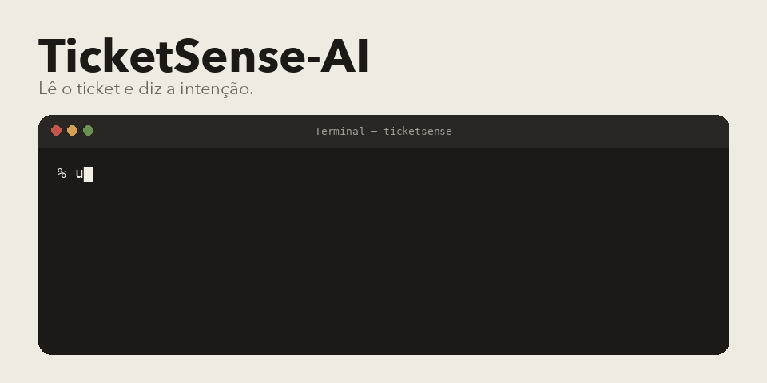

<p align="center">
  
</p>

TicketSense-AI lê uma mensagem de suporte e diz a intenção. Pagamento, cancelamento, suporte, o que estiver no conjunto treinado. A API devolve isso para o resto do atendimento, sem eu precisar abrir o ticket na mão.

O número do gif é um exemplo do contrato. A intenção real sai do modelo que estiver em `artifacts/`.

## Do que é feito

Python. FastAPI na frente, Transformers e PyTorch no treino, DistilBERT como base. Dá para mandar artefato ao Google Cloud Storage se a credencial existir. Tem cliente de OpenAI e de Gemini nos scripts que geram dado sintético. Isso é ferramenta de dataset, não é o classificador em si.

## O caminho

1. O dataset fica em JSONL, uma conversa por linha.
2. `scripts/format_dataset.py` e `scripts/prepare_dataset.py` arrumam e conferem.
3. `python -m trainer.train` treina e guarda o artefato.
4. A API carrega esse artefato e responde.

```bash
python3 -m venv .venv
source .venv/bin/activate
pip install -r requirements.txt
python -m trainer.train
uvicorn api.inference:app --reload --port 8000
```

`POST /predict_intent` recebe `text`. A resposta traz `intent` e `confidence`. Também tem `/predict_batch`, `/health` e `/model_info`.

Mais contexto em `docs/README.md`.

Pedro Américo Paletot, [peamericoo](https://github.com/peamericoo).
